# VitaCare AI — Entity-Relationship Diagram (ERD) & Data Dictionary

This document specifies the complete, HIPAA/GDPR-compliant PostgreSQL database architecture for the VitaCare AI Health application.

---

## 1. Entity-Relationship Diagram (Mermaid)

```mermaid
erDiagram
    users ||--|| user_profiles : "has 1:1"
    users ||--o{ authentication_sessions : "issues"
    users ||--o{ privacy_consents : "grants"
    users ||--o{ chat_conversations : "owns"
    chat_conversations ||--o{ chat_messages : "contains"
    users ||--o{ medical_documents : "uploads"
    medical_documents ||--o{ document_extractions : "yields"
    users ||--o{ health_records : "tracks"
    medical_documents ||--o{ health_records : "sources"
    users ||--o{ medications : "prescribed"
    medical_documents ||--o{ medications : "evidenced_by"
    medications ||--o{ medication_schedules : "scheduled_as"
    medications ||--o{ medication_intake_logs : "adherence_logged"
    medication_schedules ||--o{ medication_intake_logs : "triggers"
    users ||--o{ appointments : "books"
    users ||--o{ notifications : "receives"
    users ||--o{ audit_events : "audited_as_actor"
    users ||--o{ data_deletion_requests : "initiates"
    users ||--o{ guardians : "designates"
    users ||--o{ wellness_logs : "records_daily"
    users ||--o{ symptom_assessments : "completes_triage"
    medical_knowledge_sources ||--o{ medical_knowledge_chunks : "segments"

    users {
        uuid id PK
        string phone_number UK
        string email UK
        string password_hash
        string role
        string account_status
        timestamp phone_verified_at
        timestamp created_at
        timestamp updated_at
        timestamp deleted_at
    }

    user_profiles {
        uuid id PK
        uuid user_id FK,UK
        string display_name
        date date_of_birth
        string gender
        string blood_group
        string profile_photo_reference
        string preferred_language
        string timezone
        string emergency_contact_reference
        jsonb allergies_json
        jsonb chronic_conditions_json
        jsonb current_medications_json
        numeric height_cm
        numeric weight_kg
        string primary_physician
        timestamp created_at
        timestamp updated_at
    }

    authentication_sessions {
        uuid id PK
        uuid user_id FK
        string session_or_token_hash UK
        timestamp issued_at
        timestamp expires_at
        timestamp revoked_at
        jsonb device_metadata
        string ip_address
    }

    privacy_consents {
        uuid id PK
        uuid user_id FK
        string consent_type
        string policy_version
        boolean granted
        timestamp granted_at
        timestamp withdrawn_at
        text purpose_and_scope
    }

    chat_conversations {
        uuid id PK
        uuid user_id FK
        string title
        string language
        timestamp created_at
        timestamp updated_at
        timestamp archived_at
        timestamp deleted_at
    }

    chat_messages {
        uuid id PK
        uuid conversation_id FK
        string sender_role
        text message_text
        string model_identifier
        jsonb response_metadata
        string safety_status
        timestamp created_at
    }

    medical_documents {
        uuid id PK
        uuid user_id FK
        string document_type
        string original_filename
        string private_storage_key UK
        string mime_type
        integer file_size
        string checksum
        string upload_status
        string processing_status
        timestamp uploaded_at
        timestamp processed_at
        timestamp deleted_at
    }

    document_extractions {
        uuid id PK
        uuid document_id FK
        string extraction_version
        jsonb extracted_data_json
        numeric extraction_confidence
        string review_status
        timestamp user_confirmed_at
        timestamp created_at
    }

    health_records {
        uuid id PK
        uuid user_id FK
        string record_type
        string biomarker_name
        timestamp record_date
        numeric numeric_value
        string string_value
        jsonb structured_value
        string unit
        string status
        string source_type
        uuid source_document_id FK
        timestamp user_verified_at
        timestamp created_at
        timestamp updated_at
    }

    medications {
        uuid id PK
        uuid user_id FK
        string medication_name
        string strength
        text dosage_instructions
        uuid source_document_id FK
        string verification_status
        date start_date
        date end_date
        string status
        timestamp created_at
        timestamp updated_at
    }

    medication_schedules {
        uuid id PK
        uuid medication_id FK
        jsonb schedule_definition
        string timezone
        timestamp start_at
        timestamp end_at
        boolean active
        timestamp created_at
        timestamp updated_at
    }

    medication_intake_logs {
        uuid id PK
        uuid medication_id FK
        uuid schedule_id FK
        timestamp scheduled_at
        string status
        timestamp recorded_at
        string user_note
    }

    appointments {
        uuid id PK
        uuid user_id FK
        string clinician_or_facility_reference
        string appointment_title
        string specialty
        timestamp scheduled_start
        timestamp scheduled_end
        string timezone
        string status
        text notes
        timestamp created_at
        timestamp updated_at
    }

    notifications {
        uuid id PK
        uuid user_id FK
        string notification_type
        string title
        text message
        timestamp scheduled_at
        timestamp sent_at
        string delivery_status
        integer retry_count
        string idempotency_key UK
        timestamp created_at
    }

    audit_events {
        uuid id PK
        uuid actor_user_id FK
        string action_type
        string target_type
        string target_id
        timestamp timestamp
        jsonb minimal_metadata
        string ip_address
    }

    data_deletion_requests {
        uuid id PK
        uuid user_id FK
        timestamp requested_at
        string status
        timestamp completed_at
        text outcome_summary
    }

    medical_knowledge_sources {
        uuid id PK
        string source_name
        string authoritative_body
        date publication_date
        string version
        string license_type
        timestamp created_at
    }

    medical_knowledge_chunks {
        uuid id PK
        uuid source_id FK
        string topic
        string keywords
        text clinical_guideline_text
        string target_demographic
        timestamp created_at
    }
```

---

## 2. Comprehensive Data Dictionary

### Table A: `users`
Core identity table. Passwords are never stored in plaintext (Argon2id/Bcrypt only). No OTP values or national IDs (such as Aadhaar) are stored.

| Column | Type | Constraints | Description |
| :--- | :--- | :--- | :--- |
| `id` | UUID | PK, DEFAULT `gen_random_uuid()` | Immutable global user identifier. |
| `phone_number` | VARCHAR(30) | UNIQUE, NULLABLE | E.164 normalized phone number for SMS authentication and triage. |
| `email` | VARCHAR(255) | UNIQUE, NOT NULL | Normalized lowercase user email address. |
| `password_hash` | VARCHAR(255) | NOT NULL | Salted cryptographic password hash. |
| `role` | VARCHAR(50) | NOT NULL, CHECK in `('patient', 'guardian', 'clinician', 'admin')` | Platform access tier. |
| `account_status` | VARCHAR(30) | NOT NULL, CHECK in `('active', 'pending_verification', 'suspended', 'deleted')` | Account security status. |
| `phone_verified_at` | TIMESTAMPTZ | NULLABLE | UTC timestamp when phone number ownership was confirmed. |
| `created_at` | TIMESTAMPTZ | NOT NULL, DEFAULT NOW() | Registration timestamp. |
| `updated_at` | TIMESTAMPTZ | NOT NULL, DEFAULT NOW() | Last account modification timestamp. |
| `deleted_at` | TIMESTAMPTZ | NULLABLE | Soft deletion timestamp for GDPR / DPDP statutory retention. |

---

### Table B: `user_profiles`
Personal demographic and baseline health profile. Strictly 1-to-1 with `users`. Does not collect sensitive government IDs.

| Column | Type | Constraints | Description |
| :--- | :--- | :--- | :--- |
| `id` | UUID | PK, DEFAULT `gen_random_uuid()` | Profile record ID. |
| `user_id` | UUID | FK -> `users.id` ON DELETE CASCADE, UNIQUE | Associated patient account. |
| `display_name` | VARCHAR(255) | NOT NULL | Preferred patient name for communication and reports. |
| `date_of_birth` | DATE | NULLABLE | Birth date for clinical pediatric/geriatric dosage adjustments. |
| `gender` | VARCHAR(50) | DEFAULT 'Unspecified' | Biological sex / gender identity. |
| `blood_group` | VARCHAR(10) | CHECK in `('A+', 'A-', 'B+', 'B-', 'AB+', 'AB-', 'O+', 'O-')` | ABO / Rh blood group. |
| `profile_photo_reference` | VARCHAR(500) | NULLABLE | S3 private object storage reference for profile photo. |
| `preferred_language` | VARCHAR(10) | NOT NULL, DEFAULT 'en' | ISO 639-1 code (`en`, `ta`, `hi`, `te`, `ml`, `kn`). |
| `timezone` | VARCHAR(50) | NOT NULL, DEFAULT 'Asia/Kolkata' | IANA timezone string for reminder scheduling. |
| `emergency_contact_reference`| VARCHAR(255) | NULLABLE | Primary emergency contact name & relation. |
| `allergies_json` | JSONB | NOT NULL, DEFAULT `'[]'` | Verified allergic reactions and sensitivities. |
| `chronic_conditions_json` | JSONB | NOT NULL, DEFAULT `'[]'` | Verified chronic conditions (e.g. Type 2 Diabetes). |
| `current_medications_json` | JSONB | NOT NULL, DEFAULT `'[]'` | Verified active medications summary. |
| `height_cm` | NUMERIC(5,2)| CHECK (30 < height_cm < 280) | Patient height in centimeters. |
| `weight_kg` | NUMERIC(5,2)| CHECK (1 < weight_kg < 400) | Patient weight in kilograms. |
| `primary_physician` | VARCHAR(255) | NULLABLE | Attending clinician and clinic name. |
| `created_at` / `updated_at` | TIMESTAMPTZ | NOT NULL | Audit timestamps. |

---

### Table C: `authentication_sessions`
Hashed refresh tokens and active mobile/web sessions. Prevents raw token leakage in database dumps.

| Column | Type | Constraints | Description |
| :--- | :--- | :--- | :--- |
| `id` | UUID | PK, DEFAULT `gen_random_uuid()` | Session identifier. |
| `user_id` | UUID | FK -> `users.id` ON DELETE CASCADE | Associated authenticated patient. |
| `session_or_token_hash` | VARCHAR(64) | UNIQUE, NOT NULL | SHA-256 hash of refresh token. |
| `issued_at` | TIMESTAMPTZ | NOT NULL, DEFAULT NOW() | Token creation timestamp. |
| `expires_at` | TIMESTAMPTZ | NOT NULL | Token invalidation timestamp. |
| `revoked_at` | TIMESTAMPTZ | NULLABLE | Explicit logout / revocation timestamp. |
| `device_metadata` | JSONB | DEFAULT `'{}'` | Minimized OS / client user-agent string. |
| `ip_address` | VARCHAR(45) | NULLABLE | IPv4 or IPv6 client origin. |

---

### Table D: `privacy_consents`
Granular privacy choices compliant with DPDP Act 2023 and GDPR Article 7.

| Column | Type | Constraints | Description |
| :--- | :--- | :--- | :--- |
| `id` | UUID | PK, DEFAULT `gen_random_uuid()` | Consent record ID. |
| `user_id` | UUID | FK -> `users.id` ON DELETE CASCADE | Patient granting or withdrawing consent. |
| `consent_type` | VARCHAR(100)| CHECK in `('account_terms', 'ai_processing', 'guardian_sharing', 'emergency_alerts', 'marketing', 'teleconsult')` | Purpose classification. |
| `policy_version` | VARCHAR(20) | NOT NULL, DEFAULT 'v1.0' | Privacy terms version. |
| `granted` | BOOLEAN | NOT NULL, DEFAULT TRUE | Affirmative consent decision. |
| `granted_at` | TIMESTAMPTZ | NOT NULL, DEFAULT NOW() | Timestamp of consent affirmation. |
| `withdrawn_at` | TIMESTAMPTZ | NULLABLE | Timestamp of consent withdrawal. |
| `purpose_and_scope` | TEXT | NOT NULL | Plain-language statement of data processing scope. |

*Unique Constraint:* `(user_id, consent_type, policy_version)`.

---

### Table E & F: `chat_conversations` & `chat_messages`
Confidential patient-AI conversations. Isolated by tenant and subject to configurable retention policies.

#### `chat_conversations`
- `id`: UUID Primary Key.
- `user_id`: FK -> `users.id` ON DELETE CASCADE.
- `title`: Consultation session topic.
- `language`: Consultation language (`en`, `ta`, `hi`, `te`).
- `created_at`, `updated_at`, `archived_at`, `deleted_at`: Session lifecycle timestamps.

#### `chat_messages`
- `id`: UUID Primary Key.
- `conversation_id`: FK -> `chat_conversations.id` ON DELETE CASCADE.
- `sender_role`: CHECK in `('user', 'assistant', 'system')`.
- `message_text`: Clinical question or AI response.
- `model_identifier`: Name of underlying model (e.g. `gemini-1.5-pro`, `claude-3-7-sonnet`).
- `response_metadata`: Minimized clinical breakdown (confidence, triage flags, citations).
- `safety_status`: CHECK in `('safe', 'escalated_emergency', 'warning', 'flagged')`.

---

### Table G & H: `medical_documents` & `document_extractions`
Secure document metadata. Actual file binaries are stored exclusively in private S3-compatible object storage with cryptographic checksums.

#### `medical_documents`
- `id`: UUID Primary Key.
- `user_id`: FK -> `users.id` ON DELETE CASCADE.
- `document_type`: CHECK in `('prescription', 'lab_report', 'discharge_summary', 'imaging', 'other')`.
- `original_filename`: Sanitized original uploaded filename.
- `private_storage_key`: Unique internal object storage URI (never exposed directly to client).
- `mime_type`: Content type.
- `file_size`: CHECK `file_size >= 0`.
- `checksum`: SHA-256 integrity hash.
- `upload_status`: CHECK in `('pending', 'uploaded', 'failed')`.
- `processing_status`: CHECK in `('unprocessed', 'queued', 'processing', 'completed', 'failed')`.
- `uploaded_at`, `processed_at`, `deleted_at`: Lifecycle timestamps.

#### `document_extractions`
- `id`: UUID Primary Key.
- `document_id`: FK -> `medical_documents.id` ON DELETE CASCADE.
- `extraction_version`: AI extraction engine version (e.g. `v1.2`).
- `extracted_data_json`: Structured JSON containing detected medications, dosages, or lab biomarkers.
- `extraction_confidence`: NUMERIC(4,3) CHECK `0.0 <= extraction_confidence <= 1.0`.
- `review_status`: CHECK in `('unverified', 'partially_verified', 'verified', 'rejected')`. Stored as `unverified` by default until confirmed by user.
- `user_confirmed_at`: UTC timestamp of user verification.

---

### Table I: `health_records`
Normalized table for lab results, vital signs, allergies, and history. Avoids polymorphic column anti-patterns by providing clean typing.

| Column | Type | Constraints | Description |
| :--- | :--- | :--- | :--- |
| `id` | UUID | PK, DEFAULT `gen_random_uuid()` | Record ID. |
| `user_id` | UUID | FK -> `users.id` ON DELETE CASCADE | Associated patient. |
| `record_type` | VARCHAR(50) | CHECK in `('vital_sign', 'lab_result', 'allergy', 'condition', 'immunization', 'history')` | Clinical domain. |
| `biomarker_name` | VARCHAR(100)| NOT NULL | Standard biomarker identifier (e.g. `hba1c`, `blood_glucose`, `bp_systolic`). |
| `record_date` | TIMESTAMPTZ | NOT NULL, DEFAULT NOW() | Clinical occurrence date/time. |
| `numeric_value` | NUMERIC(10,3)| NULLABLE | Quantitative clinical value (e.g. `6.8`, `124.0`). |
| `string_value` | VARCHAR(255) | NULLABLE | Qualitative clinical value (e.g. `Positive`, `Penicillin`). |
| `structured_value`| JSONB | NULLABLE | Complex multi-component measurements (e.g. ECG intervals). |
| `unit` | VARCHAR(50) | NULLABLE | Measurement unit (e.g. `mg/dL`, `mmHg`, `%`). |
| `status` | VARCHAR(30) | CHECK in `('normal', 'elevated', 'low', 'critical', 'abnormal')` | Clinical triage category. |
| `source_type` | VARCHAR(50) | CHECK in `('manual_entry', 'ocr_extraction', 'device_sync', 'clinical_import')` | Data provenance. |
| `source_document_id`| UUID | FK -> `medical_documents.id` ON DELETE SET NULL | Source document reference for user comparison. |
| `user_verified_at` | TIMESTAMPTZ | NULLABLE | Timestamp when patient confirmed value. |

---

### Table J, K, L: `medications`, `medication_schedules`, `medication_intake_logs`
Three-tier medication architecture ensuring clinical safety and duplicate prevention.

#### `medications`
- Prescribed pharmacologic entity.
- `verification_status` CHECK in `('unverified', 'verified_by_user', 'verified_by_pharmacist')`.
- AI-extracted dosages are NEVER assumed correct; marked `unverified` until user confirms.
- `chk_medication_date_range`: CHECK `end_date >= start_date`.

#### `medication_schedules`
- `schedule_definition`: JSONB format defining recurrence rules and times of day (`{"frequency": "once_daily", "times_of_day": ["08:00 AM"]}`).
- `timezone`: IANA timezone for local reminder calculation.
- `chk_schedule_dates`: CHECK `end_at >= start_at`.

#### `medication_intake_logs`
- Intake confirmation record.
- `status`: CHECK in `('taken', 'skipped', 'missed', 'pending')`.
- `uq_med_intake_occurrence`: **UNIQUE CONSTRAINT ON `(medication_id, scheduled_at)`**. Completely prevents race conditions or duplicate intake logging for the same scheduled occurrence.

---

### Table M: `appointments`
Outpatient visit coordination.
- `clinician_or_facility_reference`: Attending physician or clinic name.
- `scheduled_start`, `scheduled_end`: Booking interval.
- `chk_appt_duration`: CHECK `scheduled_end >= scheduled_start`.
- `status`: CHECK in `('scheduled', 'confirmed', 'completed', 'cancelled', 'rescheduled')`.

---

### Table N: `notifications`
Secure notification queue.
- `notification_type`: CHECK in `('medication_reminder', 'appointment_alert', 'lab_ready', 'emergency_sos', 'system')`.
- **PHI Minimization**: Push notification payload contains generic message text (e.g. "Time for your evening medication") rather than exposing full medication dosages or confidential diagnoses on device lockscreens.
- `idempotency_key`: UNIQUE VARCHAR(100) preventing duplicate push notification dispatches across network retries.

---

### Table O: `audit_events`
Immutable HIPAA audit trail.
- `actor_user_id`: FK -> `users.id` ON DELETE SET NULL (never drops compliance log if user is deleted).
- `action_type`: `USER_LOGIN`, `DOCUMENT_UPLOAD`, `MEDICATION_CONFIRMED`, `DATA_EXPORT`, `DATA_ERASURE`.
- Minimal metadata without raw PHI or secrets.

---

### Table P: `data_deletion_requests`
GDPR / DPDP statutory erasure tracking.
- Tracks multi-system deletion across PostgreSQL, private S3 object storage, search caches, and backup retention timelines.
- `status`: CHECK in `('pending', 'processing', 'completed', 'rejected')`.

---

### Table Q: `medical_knowledge_sources` & `medical_knowledge_chunks`
Authoritative clinical knowledge base (ADA, AHA, WHO) strictly separated from private patient records.
- Patient health records are NEVER mixed with general clinical guidelines.
- Patient health data is NEVER used for public LLM training.
